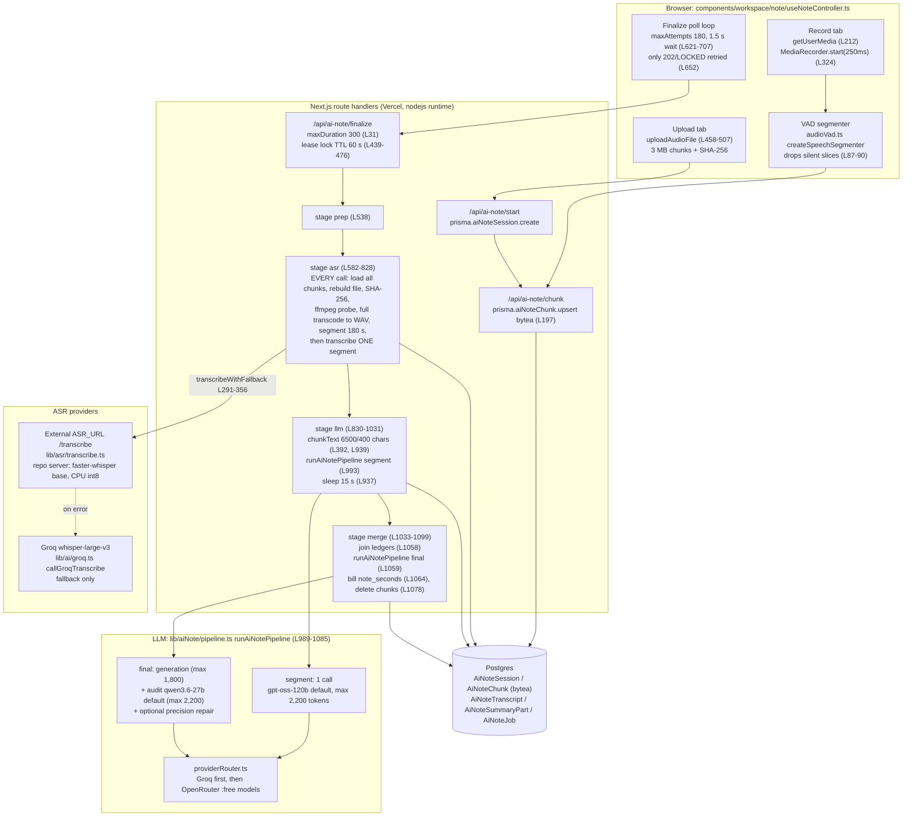

# Audio-to-Notes System Audit

**Date:** 2026-10-15
**Scope:** Audio upload, in-browser recording, transcription, transcript segmentation, note generation, quota and billing, and data retention for AI Note (`/ai-note`).
**Method:** Read-only code inspection, the existing unit tests, and two local experiments that used no network and no user data (described in §2.4). No production configuration, prompts, models, schemas, or data were changed. No paid API calls were made, and nothing was deployed.
**Repository state audited:** branch `claude/confident-cori-ohkwsh` at `a6c1b53`.

### Implementation status (P0 iteration, 2026-10-15)

The P0 fixes are on branch `claude/confident-cori-ohkwsh`. They are not merged or deployed. The findings below describe the audited commit `a6c1b53`.

| Finding | Status | Commit(s) |
|---|---|---|
| F-01 WebM header loss | Fixed: no recorder slice is ever dropped; record chunks must be contiguous; chunk-upload retries | `04f59de` |
| F-02 JSON in transcript | Fixed: shared response parser; explicit no-speech segments | `94f6152` |
| F-03 / F-04 limits after ASR | Partly fixed: daily limit, cooldown, and weekly quota (using verified duration) are checked before transcription. **Still after ASR:** the plan's transcript-character limit, which needs a product decision on per-plan minute limits. | `a49ea84`, `1e286b9` |
| F-05 wall-clock billing | Fixed: billed from the decoded duration | `a49ea84`, `0f07952` |
| F-08 retention | Partly fixed: completed notes no longer keep transcripts or ledgers. Abandoned and failed sessions still need approved periods (see `docs/audits/audio-retention.md`). | `0c8d90b` |
| F-09 legacy endpoints | Fixed: `/process` returns 410, and `/api/ai-note` accepts text only | `ea80496` |
| Others (F-06, F-07, F-10 to F-20) | Not started | — |

### Evidence labels used in this report

| Label | Meaning |
|---|---|
| **FACT** | Directly visible in the code at the cited file and line. |
| **MEASURED** | Reproduced locally in this audit, using the method in §2.4. |
| **ESTIMATE** | Derived arithmetically from stated assumptions. It is not a measurement of production. |
| **HYPOTHESIS** | Plausible, but not proven. The report says what evidence would confirm or refute it. |
| **RECOMMENDATION** | A proposed change. Nothing here has been implemented. |

Line numbers refer to the audited commit.

---

## 1. Executive Summary

The audio-to-notes pipeline is a client-driven "stepper". The browser repeatedly calls `POST /api/ai-note/finalize`, and each call advances one unit of work: prep → one ASR segment → one LLM segment → final merge. Progress is persisted in Postgres, so a failed step can resume. That basic design is sound. The code also has upload integrity checks (SHA-256, byte counts), a provider-fallback router with structured attempt logs, transcript canonicalization with hashes, and an explicit grounding-oriented prompt design.

The audit found several defects that are likely to affect real users today. Three are **reproduced or directly visible**:

1. **Recordings can become undecodable (F-01, MEASURED).** The client-side voice-activity segmenter discards silent `MediaRecorder` slices. If the first ~0.5 s of a recording is quiet, the first slice is discarded, and that slice carries the WebM container header. In a local Chromium experiment, removing that slice made ffmpeg fail with `EBML header parsing failed`. With the header gone, the server cannot decode the whole recording.
2. **Silent audio turns into JSON text in the transcript (F-02, MEASURED).** When the external ASR server returns `{"ok":true,"text":""}` (its normal response for a silent segment), `lib/asr/transcribe.ts:116` falls back to the raw response body. The transcript then contains the literal string `{"ok":true,"text":"","language":"en"}`.
3. **Most plans cannot process a normal-length lecture, and they find out only after transcription (F-03, FACT + ESTIMATE).** Plan input limits are enforced on transcript characters *after* ASR has finished. Basic allows 12,000 characters and Pro allows 30,000. At an assumed ~840 characters per spoken minute, that is roughly 14 and 36 minutes. A 50–90 minute lecture on Basic or Pro is transcribed in full and then rejected with "This text is too long for your current plan."

Other high-impact issues:
- Quota is checked after ASR (F-04).
- Uploads are billed by wall-clock time, not audio duration (F-05).
- Every ASR step re-downloads and re-transcodes the entire recording (F-06).
- Retry and timeout budgets exceed the 300 s function limit (F-07).
- Audio and transcripts are retained in ways the privacy page does not describe (F-08).
- A legacy endpoint is still reachable and has no quota checks (F-09).

On quality, the final note is hard-capped at about 1,800–2,200 output tokens regardless of lecture length (F-13). The grounding audit checks the draft against LLM-written segment ledgers, not against the transcript (F-20). The final, audit, and repair prompts carry chemistry-specific rules into every lecture (F-14).

**This report does not claim any measured accuracy, latency, or cost for production.** No production logs, token counts, or provider invoices were available. §6 includes an evaluation plan to produce those numbers, and §12 lists what is unknown.

**Recommended path:** stabilize first (Option A in §9: the P0 and P1 items, mostly small, local changes). Then decide on deeper restructuring (Option B) using data from the evaluation plan, not assumptions.

---

## 2. Verified Current Architecture

### 2.1 Entry points

| Path | Used by UI? | Purpose | Evidence |
|---|---|---|---|
| `POST /api/ai-note/start` | Yes | Creates `AiNoteSession` (validates size ≤100 MB and SHA-256 for uploads). `DELETE` cancels. | `app/api/ai-note/start/route.ts:24-75` |
| `POST /api/ai-note/chunk` | Yes | Stores one ≤3 MB audio chunk as `bytea` in `AiNoteChunk`. | `app/api/ai-note/chunk/route.ts:168-214` |
| `POST /api/ai-note/finalize` | Yes (polled) | Stepper: prep → asr → llm → merge → done. | `app/api/ai-note/finalize/route.ts` (1,175 lines) |
| `POST /api/ai-note/status` | Yes (resume only) | Reads job state and the partial note. | `app/api/ai-note/status/route.ts` |
| `POST /api/ai-note` | Yes, **text tab only** | Text → notes (`lib/aiNote/staged.ts`, `generate.ts`). Also accepts multipart audio, but the UI never sends audio here. | `app/api/ai-note/route.ts:60-79`; caller `useNoteController.ts:559` |
| `POST /api/ai-note/process` | **No** | Legacy one-shot audio → Groq Whisper → free-model notes. No quota checks. | `app/api/ai-note/process/route.ts` (see F-09) |
| `POST /api/ai-note/finalize-step` | No | Disabled, returns 410. | `app/api/ai-note/finalize-step/route.ts` |
| `GET /api/ai-note/health` | Owner only | ffmpeg, temp directory, and provider reachability. | `app/api/ai-note/health/route.ts` |

UI callers were found with `grep -rn "api/ai-note"` over `components`, `app`, and `lib`. Only the paths marked "Yes" have callers.

### 2.2 Execution path (FACT)

### 2.3 Data model (FACT, `prisma/schema.prisma:305-388`)

- `AiNoteSession`: one row per note attempt. Cascades to chunks, transcripts, and summary parts.
- `AiNoteChunk.data Bytes`: raw audio. Deleted only on successful completion (`finalize/route.ts:899, 1078`) or user cancel (`start/route.ts:91`).
- `AiNoteTranscript`: `text`, `rawText`, `canonicalText`, and hashes per ASR segment. No timestamps. **Never deleted.**
- `AiNoteSummaryPart`: segment evidence ledgers. **Never deleted.**
- `AiNoteJob`: stage, progress, lock, `noteMarkdown`, `secondsBilled`.

### 2.4 Local experiments run during this audit

Both experiments ran entirely on the build machine. They made no external network calls, used no user recordings, and changed no repository files. Scripts are kept outside the repository.

1. **MediaRecorder slice experiment (MEASURED).** Headless Chromium (Playwright, `--use-fake-device-for-media-stream`) recorded 4 s with `MediaRecorder.start(250)`. Chromium selected `audio/webm;codecs=opus` because it does not report support for `audio/ogg`. This produced 14 slices; the first was 218 bytes. The slices were concatenated the way the server does it, then decoded with the repository's `ffmpeg-static`:
   - All slices: decoded 3.96 s.
   - **First slice removed: `EBML header parsing failed` / `Invalid data found when processing input`, exit 183.**
   - Middle slices 5–8 removed: decoded 2.76 s (gap tolerated).
   - The fake device's Opus output averaged ~19.4 KB/s (~155 kbps). Real microphones may differ.
2. **ASR client empty-text experiment (MEASURED).** `transcribeAudioToText` was called with `fetch` stubbed to return exactly what `asr_server/server.py:29` returns for audio with no speech: `{"ok":true,"text":"","language":"en"}`. The function returned the string `{"ok":true,"text":"","language":"en"}`. `canonicalizeTranscriptText` treats it as non-empty.
3. **Prompt sizes (MEASURED).** The prompt builders were called locally with empty content:

   | Prompt | Characters |
   |---|---|
   | Segment system | 6,866 |
   | Segment user wrapper | 504 |
   | Final system | 11,960 |
   | Final user wrapper | 622 |
   | Audit system | 3,917 |
   | Audit user wrapper | 466 |
   | Repair system | 2,211 |
   | Repair user wrapper | 507 |

4. **Existing tests.** `npx vitest run` passed 75 of 75 tests across 9 files: the 8 `tests/api/ai-note-*.test.ts` files and `tests/note/audio-vad.test.ts`. All are mocked and offline. Note that `audio-vad.test.ts` *asserts* the slice-dropping behaviour behind F-01: in its "skips silent slices" case, the first slice `s0` is discarded.

---

## 3. Critical Findings

Severity scale: **Critical** (core flow broken for many users, or a business-model leak), **High**, **Medium**, **Low**. Complexity refers to the fix, not the problem.

### F-01 — Recordings lose the WebM header when they start quietly
| | |
|---|---|
| **Severity** | Critical |
| **Evidence** | **Recording:** `useNoteController.ts:25-31` sets 250 ms slices and an RMS threshold of 0.02; `:291-302` sends every slice through the segmenter; `:212` calls `getUserMedia({ audio: true })` with browser-default noise suppression. **Segmenter:** `audioVad.ts:87-90` keeps only the last `preSpeechPadSlices` (=1) silent slices before speech, and discards earlier ones. **Server:** `finalize/route.ts:654-669` concatenates the stored chunks and `:679-685` probes the result. **Tests:** `tests/note/audio-vad.test.ts` expects `s0` to be dropped. **Experiment:** §2.4 #1 (MEASURED). **Known limitation:** `finalize-step/route.ts` already says timeslice chunks are "not standalone WebM". |
| **Root cause** | Only the first `MediaRecorder` blob carries the container header (EBML/Tracks). The segmenter treats it like any other silent slice. If slices 0 and 1 are both below the threshold, slice 0 is discarded and never uploaded. |
| **User impact** | The recording fails at the ASR stage with `AUDIO_VALIDATION_FAILED` after the user has recorded the whole lecture. That data is unrecoverable, because only the speech slices were uploaded. Frequency is **unknown**: it depends on room noise, the microphone, and when the speaker starts. A lecture that begins with ~0.5 s of quiet is a plausible scenario (HYPOTHESIS). To confirm, search production logs for `AUDIO_VALIDATION_FAILED` / `EBML header` on `sourceType=record`. |
| **Solution** | RECOMMENDATION: always upload slice 0, or stop dropping slices client-side and let server-side VAD (`vad_filter=True` already exists in the ASR server) handle silence. Add a regression test that decodes a concatenation produced by the segmenter. |
| **Complexity** | Low |
| **Confidence** | High that losing slice 0 breaks decoding (measured in Chromium). Medium on how often it happens. Firefox and Safari were not tested. |

### F-02 — ASR "no speech" responses become literal JSON in the transcript
| | |
|---|---|
| **Severity** | High |
| **Evidence** | `lib/asr/transcribe.ts:116` returns `json?.text \|\| json?.transcript \|\| raw`. `asr_server/server.py:27-29` returns `text: ""` when VAD removes all speech. `finalize/route.ts:316` accepts any non-empty canonical text. §2.4 #2 (MEASURED). |
| **Root cause** | An empty-string `text` is falsy, so the code falls through to the raw response body. |
| **User impact** | Any 180 s segment without speech (a break, a silent tail) adds `{"ok":true,"text":"","language":"en"}` to the transcript. A fully silent recording never triggers the `EMPTY_TRANSCRIPT` message (`finalize/route.ts:842`). Instead it runs the LLM stages on JSON fragments, which costs tokens and likely ends in a quality-gate failure with a less helpful message. The same fallback also turns a non-JSON 200 body (for example an HTML error page from a proxy) into transcript text. |
| **Solution** | RECOMMENDATION: when the body parses as JSON, use only `json.text` (an empty string is valid). Use `raw` only when the response is `text/plain`. Treat an empty result as "no speech" for that segment. |
| **Complexity** | Low |
| **Confidence** | High (measured with a stubbed response identical to the repository's ASR server). It applies only if the deployed ASR returns that shape (see §12). |

### F-03 — Plan transcript limits are enforced after full transcription and are shorter than typical lectures
| | |
|---|---|
| **Severity** | Critical |
| **Evidence** | `lib/plans/productLimits.ts:77` (Basic `maxInputChars: 12_000`), `:121` (Pro `30_000`), `:165` (Ultra `60_000`, but Ultra is `unlimited`, `lib/billing/access.ts:94`). `lib/aiNote/quota.ts` `assertNoteRequestAllowed`: `stagedMaxChars = min(getStagedNoteMaxChars(), limits.maxInputChars)` and throws `NOTE_INPUT_TOO_LARGE` when exceeded. Called only in the LLM stage, `finalize/route.ts:860`, after every ASR segment is done. |
| **Root cause** | Text-tab character limits are reused for audio, and they are checked at the end of transcription instead of before it. |
| **User impact** | ESTIMATE: at 130–160 words/min and ~6 characters/word (~780–960 characters/min; midpoint 840 is used below), Basic tops out around **13–15 minutes** and Pro around **31–38 minutes**. A 50-minute lecture is about 42,000 characters. Basic and Pro users who record a normal lecture wait through full transcription and then see a text-length error for an audio file. ASR compute is spent and nothing is delivered. |
| **Solution** | RECOMMENDATION: decide product limits in **minutes of audio**. Check them in `prep` using the duration ffmpeg already reports (`finalize/route.ts:686`), before any ASR, and show the limit in the UI before upload or recording. |
| **Complexity** | Low–Medium (the product decision on limits is the larger part). |
| **Confidence** | High on the mechanism. The minute figures are estimates. |

### F-04 — Usage quota is checked only after ASR
| | |
|---|---|
| **Severity** | High |
| **Evidence** | `assertQuotaOrThrow({ action: "note", amount: recordedSeconds })` appears only at `finalize/route.ts:923`, in the LLM stage. The daily-generation and cooldown checks are at `:860`. `prep` and `asr` have no quota checks. |
| **User impact / business impact** | Users who are out of weekly note-seconds still trigger full ASR, which is the most compute-heavy stage, and then fail. Their wait time and the operator's compute are both wasted. |
| **Solution** | RECOMMENDATION: run quota, cooldown, and plan-duration checks in `prep`, using the probed duration. |
| **Complexity** | Low |
| **Confidence** | High |

### F-05 — Uploads are billed by wall-clock time, not audio duration
| | |
|---|---|
| **Severity** | High |
| **Evidence** | `useNoteController.ts:638` sends `totalDurationMs` only for `record`. For uploads, `deriveRecordedSeconds` (`lib/aiNote/recordingUsage.ts:20-28`) falls back to `now − session.createdAt`. That value is recomputed on every finalize call (`finalize/route.ts:502-506`) and billed at merge (`:1064`). The real duration is probed at `:686` but only logged. For recordings, the client value is the wall-clock from start to stop (`useNoteController.ts` `onstop`), so it includes silence. |
| **Impact** | A long file that uploads and processes quickly is billed for the processing time, not its length (under-billing). A short file on a slow connection is over-billed. Weekly quotas (`noteSecondsPerWeek`) therefore do not track audio actually processed. |
| **Solution** | RECOMMENDATION: bill `min(probed audio duration, plan cap)`, captured once in `prep` and stored on `AiNoteJob`. That stored value could replace the existing `secondsBilled` field, so no schema change is needed. |
| **Complexity** | Low |
| **Confidence** | High |

### F-06 — Every ASR step repeats the full rebuild and transcode (O(n²) work)
| | |
|---|---|
| **Severity** | High |
| **Evidence** | On every `asr` call, `finalize/route.ts:642-725` does all of the following. Then `ASR_BATCH` defaults to 1 (`:633-636`), so only one segment is transcribed per call. **Rebuild:** `findMany` loads all chunk bytes and writes the full source file. **Validate:** SHA-256 hash and `ffmpeg` probe. **Transcode:** the full file to 16 kHz WAV, then re-segment the full WAV at 180 s. |
| **Impact (ESTIMATE)** | A 120-minute recording has 40 segments, so the whole file is transcoded 40 times (~4,800 audio-minutes of decoding to process 120 minutes). Postgres serves the full blob 40 times: at the measured ~70 MB/h Opus rate, that is ~140 MB × 40 ≈ 5.6 GB read. Temporary disk per call is the source plus `full.wav` (16 kHz × 2 bytes = 32,000 B/s ≈ 230 MB for 120 min) plus the segment WAVs (another ≈ 230 MB), around 600 MB in total. That is above the 512 MB `/tmp` that Vercel documents for functions (verify for the current plan; see §12). |
| **Solution** | RECOMMENDATION: transcode and segment once in `prep`. Persist the segment WAVs, or better Opus/FLAC segments, in object storage (or as rows) and have `asr` fetch only its own segment. Stream instead of `findMany` on all bytes. |
| **Complexity** | Medium |
| **Confidence** | High on the repeated work (code). The size and time figures are estimates. |

### F-07 — Timeout and retry budgets exceed the 300 s function limit; timeouts do not cancel work
| | |
|---|---|
| **Severity** | High |
| **Evidence** | **Function limit:** `maxDuration = 300` (`finalize/route.ts:31`). **ASR budget:** `asrTimeoutMs` 180 s × `asrMaxTry` 4 for the external provider, then 180 s × 4 for Groq (`:637-638`, `:291-356`, backoff `:238-256`), so the worst case for one segment is ≫ 1,400 s. **Merge budget:** one 180 s `withTimeout` (`:1052, 1059`) wraps up to three sequential LLM calls, each with its own Groq → OpenRouter chain at 60 s per attempt by default (`lib/ai/groq.ts:34`). **No cancellation:** `withTimeout` (`:82-90`) only races a timer. It does not abort the `fetch` (`lib/asr/transcribe.ts:100` has no signal) or kill ffmpeg. **Client:** treats every status other than 202/`LOCKED` as terminal (`useNoteController.ts:652`). |
| **Impact** | When the platform kills a slow step, the browser gets a 5xx and shows a failure. Progress is kept, and uploads have a "retry" path, but the user experiences an error. Orphaned ASR requests keep the CPU-only ASR server busy, which slows the next attempt (HYPOTHESIS: a feedback loop under load). |
| **Solution** | RECOMMENDATION: derive per-attempt timeouts from a request deadline. `lib/ai/retryBudget.ts` already has `computeAttemptTimeoutMs`, but finalize does not use it. Pass `AbortSignal` to every fetch and kill ffmpeg on timeout. Have the client retry 502/503/504 a bounded number of times, since the stepper is idempotent. |
| **Complexity** | Low–Medium |
| **Confidence** | High |

### F-08 — Audio and transcripts are kept longer than the privacy page states
| | |
|---|---|
| **Severity** | High (compliance and trust) |
| **Evidence** | Audio bytes are deleted only on success or cancel (`finalize/route.ts:899, 1078`; `start/route.ts:91`). There is no scheduled cleanup: no cron in the repository, and no other code deletes `aiNoteChunk` or `aiNoteSession`. `AiNoteTranscript.rawText`/`text` and `AiNoteSummaryPart.text` are never deleted. `app/privacy/page.tsx:35` says audio inputs "are processed temporarily and are not stored long-term". |
| **Impact** | Failed, abandoned, or over-limit sessions (F-03, F-04) keep raw lecture audio in Postgres indefinitely. Every session keeps its full transcript indefinitely. |
| **Solution** | RECOMMENDATION: delete chunks on terminal failure. Add a scheduled cleanup for sessions older than N hours that are not `done`. Delete transcripts and summary parts once the note is done, unless a product feature needs them (then update the privacy text). Whether this is a legal issue is for the owner to judge. |
| **Complexity** | Low |
| **Confidence** | High |

### F-09 — Legacy audio endpoints are reachable and bypass quota
| | |
|---|---|
| **Severity** | High (`/process`), Medium (`/api/ai-note` multipart) |
| **Evidence** | `app/api/ai-note/process/route.ts:83-233` requires only a session. It runs no `assertNoteRequestAllowed` or `assertQuotaOrThrow`. It sends the concatenated session audio to Groq Whisper and then runs up to N+1 LLM calls. `app/api/ai-note/route.ts:68-79` transcribes a multipart upload *before* the quota checks at `:88-104`. Neither is called by the UI (§2.1). |
| **Impact** | Any signed-in user who discovers `/process` can run ASR and LLM work with no usage accounting. |
| **Solution** | RECOMMENDATION: return 410 from `/process`, the same way `finalize-step` does. Reject multipart audio in `/api/ai-note`, or move its quota check before transcription. |
| **Complexity** | Low |
| **Confidence** | High |

### F-10 — The external ASR endpoint has no authentication
| | |
|---|---|
| **Severity** | Medium |
| **Evidence** | `lib/asr/transcribe.ts:100` sends no credentials. `asr_server/server.py:8-14` allows CORS from `*` and has no auth on `/transcribe`. |
| **Impact** | If production `ASR_URL` runs this code, anyone with the URL can use the ASR compute, and lecture audio crosses the network to an endpoint with no access control (HYPOTHESIS: the deployed server is unknown). |
| **Solution** | RECOMMENDATION: shared-secret header plus an origin allowlist, or a private network. |
| **Complexity** | Low |
| **Confidence** | Medium |

### F-11 — The primary ASR is a small CPU model with no language hint, vocabulary, or timestamps
| | |
|---|---|
| **Severity** | Medium |
| **Evidence** | `asr_server/server.py:17` uses `WhisperModel("base", device="cpu", compute_type="int8")`. `:27` uses `vad_filter=True` with no `language` and no `initial_prompt`. `:29` returns `language` and `text` only, and the client ignores `language`. Groq `whisper-large-v3` is used only when the external call fails (`finalize/route.ts:324-355`), and also without a language hint (`lib/ai/groq.ts:94-122`). |
| **Impact** | HYPOTHESIS: transcription quality is likely limited by model size for technical vocabulary, accents, and noisy rooms. OpenAI's Whisper paper reports lower error rates for larger checkpoints in general. **This audit has no benchmark on AIWoven-like audio**, so it does not claim any specific gain. |
| **Solution** | RECOMMENDATION: benchmark first (§6.3). Options: run the same audio through `base`, a larger local checkpoint, and Groq `whisper-large-v3`, and compare WER/CER, latency, and cost. Pass the detected language to later steps. |
| **Complexity** | Medium (benchmark), Low–Medium (switch) |
| **Confidence** | Medium |

### F-12 — Segmentation ignores speech and sentence boundaries, and timestamps are discarded
| | |
|---|---|
| **Severity** | Medium |
| **Evidence** | **Audio:** fixed 180 s audio cuts with no overlap (`finalize/route.ts:640-641, 716`). **Joining:** segment transcripts are joined with `\n` (`transcriptCanonicalization.ts:78-85`). **Text:** chunks are cut by raw character count, 6,500 with 400 overlap (`chunkText`, `finalize/route.ts:392-409, 939`), with no sentence awareness. The text-tab path does look for paragraph and sentence breaks (`staged.ts:27-54`). **Timestamps:** the ASR returns text only. |
| **Impact** | Words and sentences at each 180 s boundary can be split or garbled. Each 6,500-character chunk can start or end mid-word. The 400-character overlap duplicates content, and only the LLM removes duplicates. Notes cannot link back to a time in the recording. |
| **Solution** | RECOMMENDATION: cut audio at silences near the target length, or overlap by a few seconds and de-duplicate. Chunk text at sentence boundaries with a token budget. Keep segment start and end times (faster-whisper and the OpenAI-compatible `verbose_json` both provide them). |
| **Complexity** | Medium |
| **Confidence** | High (code). Quality impact unmeasured. |

### F-13 — The final note length is fixed regardless of lecture length
| | |
|---|---|
| **Severity** | Medium |
| **Evidence** | `pipeline.ts:996-998`: final generation `max_tokens = min(maxTokens, 1800)`. Audit and repair use `maxTokens ≤ 2,400` (default 2,200). Meanwhile `prompts.ts:77` says "For long material, increase concept coverage proportionally". The default model `openai/gpt-oss-120b` is a reasoning model, and `reasoningEffort` is not set for generation (`pipeline.ts:1022-1031`). |
| **Impact** | ESTIMATE: a 120-minute lecture yields ~17 ledgers (~25k tokens of evidence at an assumed 1,500 tokens each). They are compressed into ≤1,800 tokens (~1,300 English words) of notes, so coverage per minute falls as length grows. HYPOTHESIS: reasoning tokens may count against `max_tokens` on Groq and truncate the visible output further. The code already strips "planning" text and rejects `<think>` output (`pipeline.ts:557`), which suggests leakage has happened before. Confirm by logging `usage` (F-16). |
| **Solution** | RECOMMENDATION: scale the output budget with input length, or build the final note section by section (hierarchical merge). Set `reasoning_effort` explicitly for generation. |
| **Complexity** | Medium |
| **Confidence** | High (cap). Medium (impact). |

### F-14 — Chemistry-specific rules and heuristics run on every lecture
| | |
|---|---|
| **Severity** | Medium |
| **Evidence** | **Prompt rules:** `prompts.ts:86-97` (`technicalPrecisionRegressionRules`: ionization energy, electron affinity, N/O exception, noble gases) is injected into every *final* system prompt (`:130`) and every precision-repair prompt (`:185`). The audit prompt has a chemistry rule hard-coded (`:162`). **Code heuristics:** `pipeline.ts:402-453` (`findStudyNotePrecisionIssues`) and `:668-682` (`applySafeStudyNotePrecisionCorrections` rewrites any line that matches "group … valence electron"). **Size:** the final system prompt measures 11,960 characters (§2.4 #3). |
| **Impact** | Every non-chemistry lecture pays for these tokens. HYPOTHESIS: they also risk steering unrelated notes. The prompt says "do not import chemistry concepts into unrelated notes", but the rules are still present. They look like fixes for one regression case that became global. |
| **Solution** | RECOMMENDATION: move subject-specific rules behind a topic check, or into an evaluation set rather than the production prompt. Do this only after the evaluation in §6 shows no regression. |
| **Complexity** | Low (code), Medium (validation) |
| **Confidence** | High (code). Impact unmeasured. |

### F-15 — Fixed 15-second sleep after every LLM segment
| | |
|---|---|
| **Severity** | Medium |
| **Evidence** | `finalize/route.ts:937` (`AI_NOTE_LLM_PAUSE_MS` default 15,000) and the `setTimeout` after each part (`:1004`). |
| **Impact** | FACT plus arithmetic: 17 parts × 15 s = 255 s of deliberate idle time for a 120-minute lecture, plus 1.5 s client sleeps between ~60 polls. It is probably a rate-limit workaround (HYPOTHESIS). The router already parses `retry-after` (`lib/ai/groq.ts:56-57`). |
| **Solution** | RECOMMENDATION: sleep only on 429, honouring `retryAfterMs`. |
| **Complexity** | Low |
| **Confidence** | High |

### F-16 — No token-usage or cost telemetry
| | |
|---|---|
| **Severity** | Medium |
| **Evidence** | `callGroqChat` and `callOpenRouterChat` return only `content` and `modelUsed` (`lib/ai/groq.ts:79`, `lib/ai/openrouter.ts:82`), discarding the provider `usage` object. Attempt logs record `estimatedInputTokens = chars/4` (`providerRouter.ts:131`). |
| **Impact** | Real cost per lecture, reasoning-token overhead, and truncation (F-13) cannot be measured. This is why §7 can only give estimates. |
| **Solution** | RECOMMENDATION: log `usage` (prompt, completion, and reasoning tokens if present), the ASR audio seconds, and the provider per attempt. Do not log content. |
| **Complexity** | Low |
| **Confidence** | High |

### F-17 — Dead and divergent code paths
| | |
|---|---|
| **Severity** | Low |
| **Evidence** | **Live transcript:** the UI expects `json.transcript` from `/chunk` (`useNoteController.ts:282`), but the route never returns it (`chunk/route.ts:206-214`). **Unused modules and functions:** `lib/aiNote/sessionStore.ts` (in-memory, no importers); the legacy outline/section/merge functions in `pipeline.ts` (`callSectionNotesRobust`, `callFinalMergeRobust`, around `:857-985`); `finalize-step`. **Inconsistent provider order:** the text tab tries OpenRouter `:free` models first (`generate.ts:5-10`, `staged.ts:20-25`), while audio tries Groq first (`providerRouter.ts:135-157`). |
| **Impact** | Maintenance cost, and confusion about which path is live. |
| **Solution** | RECOMMENDATION: remove dead paths after confirming with production logs. |
| **Complexity** | Low |
| **Confidence** | High |

### F-18 — Recording sessions have no total size cap
| | |
|---|---|
| **Severity** | Medium |
| **Evidence** | `/chunk` caps each chunk at 3 MB (`chunk/route.ts:168`) but limits neither the number of chunks per session nor the total bytes, and runs no quota check. The 100 MB cap applies only to uploads (`start/route.ts:54-58`). |
| **Impact** | ESTIMATE: at the measured ~155 kbps, a recording grows by ~70 MB/hour in Postgres `bytea`, with no ceiling. Combined with F-08, abandoned recordings accumulate. |
| **Solution** | RECOMMENDATION: enforce plan-based maximum minutes and bytes per session in `/chunk`. Set `audioBitsPerSecond` on `MediaRecorder` (speech does not need ~155 kbps). |
| **Complexity** | Low |
| **Confidence** | Medium (bitrate measured with a fake device only) |

### F-19 — Free-tier fallback models and transcript handling
| | |
|---|---|
| **Severity** | Low–Medium |
| **Evidence** | Fallback models are `:free` OpenRouter variants (`providerRouter.ts:37-41`, `generate.ts`, `staged.ts`, `process/route.ts`). |
| **Impact** | HYPOTHESIS: free endpoints can have different rate limits, availability, and data-retention terms from paid ones, so transcript content may go to providers with different policies. Verify OpenRouter account privacy settings and the providers each `:free` route uses. |
| **Solution** | RECOMMENDATION: document which providers may receive transcripts, and pin the allowed providers. |
| **Complexity** | Low |
| **Confidence** | Low–Medium |

### F-20 — The grounding audit checks LLM ledgers, not the transcript
| | |
|---|---|
| **Severity** | Medium |
| **Evidence** | In merge, `text` is the joined segment ledgers (`finalize/route.ts:1058-1059`). `runAiNotePipeline` passes that same `text` as `evidence` to the audit and repair prompts (`pipeline.ts:1036-1060`). `assessStudyNoteCandidate` measures token overlap against it (`pipeline.ts:553-565`, threshold 0.08). |
| **Impact** | An error introduced while writing a segment ledger (a hallucinated example, a wrong direction) becomes "evidence". The audit cannot catch it. A 0.08 token overlap only catches notes that are entirely unrelated. |
| **Solution** | RECOMMENDATION: give the audit the relevant transcript excerpts (or the full transcript when it fits) as primary evidence, with the ledgers as an index. Measure the unsupported-claim rate before and after (§6). |
| **Complexity** | Medium |
| **Confidence** | High (code). Impact unmeasured. |

---

## 4. Model & Prompt Analysis

### 4.1 Models in the code (FACT; production overrides unknown, see §12)

| Role | Default | Where | Settings |
|---|---|---|---|
| Primary ASR | External `ASR_URL`. The repository server uses faster-whisper `base`, CPU, int8. | `lib/asr/transcribe.ts`, `asr_server/server.py:17` | `vad_filter=True`, no language or prompt |
| Fallback ASR | Groq `whisper-large-v3` (`AI_NOTE_ASR_MODEL`) | `lib/ai/groq.ts:94-179` | 90 s default timeout (overridden to 180 s in finalize) |
| Segment ledger + final draft | `openai/gpt-oss-120b` on Groq (`AI_NOTE_STUDY_MODEL`) | `pipeline.ts:995` | temperature 0, max tokens 2,200 (segment) and 1,800 (final), reasoning effort unset |
| Audit | `qwen/qwen3.6-27b` on Groq (`AI_NOTE_AUDIT_MODEL`) | `pipeline.ts:1037` | `reasoning_effort: "none"`, max 2,200 |
| Precision repair (conditional) | `AI_NOTE_PRECISION_MODEL`, otherwise the audit model | `pipeline.ts:1063` | as audit |
| LLM fallback | OpenRouter `openai/gpt-oss-20b:free`, `nvidia/nemotron-3-super-120b-a12b:free`, `openrouter/free` | `providerRouter.ts:37-41` | Used only for Groq 408/409/429/5xx/timeout |
| Text tab | OpenRouter `:free` Gemma/Trinity models first, then Groq `gpt-oss-120b` | `generate.ts`, `staged.ts` | temperature 0.2 / 0.15 |

**Risk (HYPOTHESIS, needs verification):** a Groq 404 for an unknown model ID is *not* fallback-eligible (`isGroqFallbackEligible`, `providerRouter.ts:63-69`). If the default audit model ID is not served by the Groq account, every final merge fails instead of falling back. The production value of `AI_NOTE_AUDIT_MODEL` and the Groq model catalogue were not checked; that would need an API call or dashboard access.

No claim is made that any other model would perform better. Model choice should follow the benchmark in §6.

### 4.2 Prompt structure (FACT; sizes MEASURED)

- **Segment pass** (`prompts.ts:108-122`): extracts an "evidence ledger" with fixed headings, including *Claims Requiring Precision Review* and *Uncertainties and ASR Artifacts*. This is a good grounding-first design. The system prompt (6,866 characters) is **larger than the content it processes** (≤6,500 characters), so about half of each segment call's input is instructions (ESTIMATE using chars/4).
- **Final pass** (`prompts.ts:124-133`): includes the ~35-rule `sharedQualityRules`, the full Markdown contract, and the chemistry block (11,960 characters).
- **Audit and repair** (`prompts.ts:146-206`): rewrite the full document instead of returning a diff, so each pass re-emits the whole note and can introduce new errors while fixing others.

**Strengths:**
- Explicit source-fidelity tiers ("preserve / organize / clearly-labelled correction").
- Rules against absolutes and filler.
- No exam-prediction claims.
- Uncertainty is surfaced rather than invented.
- A fixed section order that the UI can rely on.

**Weaknesses:**
- **Rule overload.** Many overlapping imperatives (e.g. lines 25–40 of `prompts.ts`) compete for attention, and their effect is unmeasured.
- **Domain overfit** (F-14).
- **Literal label tokens.** "STAR Important" and "LIGHTNING Tip" are written as text placeholders (`prompts.ts:24`).
- **Inconsistent output contracts.** Text-tab and legacy prompts ask for other headings (`finalMergePrompt` uses "Main Notes / Important Terms / Takeaways / Study Aids").
- **Unenforceable instructions.** The prompts ask the model to "build an internal evidence ledger" and "run an internal consistency check". Nothing verifies that this happens.

---

## 5. Segmentation & Context

| Layer | Current behaviour (FACT) | Problem | Recommendation |
|---|---|---|---|
| Client capture | 250 ms slices. Silent slices dropped with a 1-slice pre-pad and 1-slice post-pad (`audioVad.ts`) | Header loss (F-01). Word onsets clipped by the 250 ms pre-pad. Pauses removed, which distorts any timing. | Upload continuously and do VAD on the server |
| Audio segmentation | Fixed 180 s, no overlap (`finalize/route.ts:640-641, 716`) | Mid-word cuts | Cut at silence near the target, or overlap by 1–2 s and de-duplicate |
| ASR context | Each segment is transcribed independently with no prompt | Inconsistent spelling of technical terms across segments | Pass the previous segment's tail and a term list as `initial_prompt` (benchmark first) |
| Transcript join | `\n` join (`transcriptCanonicalization.ts:78-85`) | Boundary artifacts | Join with boundary de-duplication |
| LLM chunking | 6,500 characters with 400-character overlap, no sentence awareness (`finalize/route.ts:392-409`) | Mid-sentence cuts. Duplicated overlap. Characters are a poor proxy for tokens in Chinese text. | Token-based, sentence-aligned chunks. Larger chunks fit the model's context, giving fewer calls and less boilerplate per call. |
| Cross-segment context | None. Each segment ledger is written blind. | Definitions introduced early are not linked later | Carry a running term and topic list into each segment call (cheap) |
| Final merge | Ledgers only; fixed output cap (F-13, F-20) | Coverage loss; audit is not grounded in the transcript | Hierarchical merge, with the audit checked against the transcript |

ESTIMATE of part counts. Assumptions: ~840 characters/min, the current `chunkText(6500, 400)` replicated locally, and 180 s ASR segments.

| Lecture | Transcript characters | ASR segments | LLM segment parts |
|---|---|---|---|
| 5 min | ~4,200 | 2 | 1 |
| 15 min | ~12,600 | 5 | 2 |
| 30 min | ~25,200 | 10 | 5 |
| 60 min | ~50,400 | 20 | 9 |
| 120 min | ~100,800 | 40 | 17 |

---

## 6. Note Quality

### 6.1 What the code guarantees (FACT)

- Required headings are normalized (`normalizeRequiredStudyNoteHeadings`).
- Fatal checks reject output that is too short, contains planning text, is missing three or more required sections, or has <0.08 token overlap with the evidence (`pipeline.ts:553-565`).
- Two candidates (draft and audited) are scored, and the better one is kept (`resolveFinalStudyNoteCandidates`, `pipeline.ts:591-666`).

### 6.2 What it does not guarantee

- **Factual grounding against the transcript (F-20).**
- **Coverage on long lectures (F-13).**
- **Verification.** No step verifies note claims against the source in a way that would justify calling the notes "verified". This audit recommends **not** using that word in the UI or in marketing until a real validation process exists.

### 6.3 Evaluation plan (proposed; requires approval for any paid API run)

**Dataset.** Use openly licensed or consented recordings only, never user recordings without consent. Each scenario gets a human reference transcript, plus a human concept list (the 10–30 ideas a student should retain) and a list of instructor examples.

| # | Scenario | Purpose |
|---|---|---|
| 1 | 5-min clean English lecture (single speaker, close mic) | Baseline |
| 2 | 15-min STEM lecture with formulas and symbols | Technical vocabulary, formula fidelity |
| 3 | 60-min humanities lecture | Long-form coverage (F-13) |
| 4 | 120-min lecture | Scalability (F-06, F-07, F-13) |
| 5 | Noisy classroom / far-field recording | ASR robustness |
| 6 | Non-native or accented English | ASR robustness |
| 7 | Mandarin lecture with Chinese–English code-switching | CER, language handling, character-based chunking |
| 8 | Browser recording that starts with 3 s of silence (Chrome, Firefox, Safari) | Regression test for F-01 |
| 9 | Recording with a long mid-lecture silence (≥3 min) | Regression test for F-02 |
| 10 | Quiz / review session with answers | "Answer Key" handling, no answer-list dominance |

**Metrics:**
- **WER** (English) and **CER** (Chinese) against the reference transcript, per ASR option.
- **Concept recall:** the share of reference concepts present in the note, judged by humans with a rubric.
- **Unsupported-claim rate:** note claims not supported by the *transcript*, per 1,000 words, by human annotation. An LLM judge may be used only as a secondary, calibrated signal.
- **Contradiction rate:** internal contradictions and direction reversals.
- **Structure compliance:** required sections present and complete, with no truncation.
- **Example fidelity:** invented examples per note.
- **Latency:** per stage and end to end, p50 and p95.
- **Failure rate:** by stage and error code.
- **Usage:** tokens and audio-seconds per stage, from the logged `usage` (F-16).
- **Cost per audio minute:** computed from that usage × the provider price list on the run date, stating the date and source.

**Procedure:** 1. Freeze the current pipeline as the baseline. 2. Run every scenario three times to observe variance. 3. Change one variable at a time: the ASR model, chunking, the output budget, or audit grounding. 4. Accept a change only if it improves the target metric without regressing the unsupported-claim rate.

---

## 7. API Cost Analysis

**No prices are stated in this report.** No provider invoices, usage logs, or current price lists were consulted, and prices change. All token figures below are **ESTIMATES** under the stated assumptions, not measurements.

**Assumptions:**
- ~840 transcript characters per minute.
- Tokens ≈ characters ÷ 4, the same heuristic the code uses (`providerRouter.ts:131`).
- Each segment ledger produces **~1,500 output tokens** (the cap is 2,200; the real value is unknown).
- Prompt sizes as measured in §2.4 #3.
- The final draft uses its 1,800-token cap and the audit its 2,200 cap.
- Reasoning tokens are **excluded** and unknown.

**Calls per lecture (FACT, from code):** `parts` segment calls + 1 final generation + 1 audit + 0–1 precision repair. ASR requests = segments, plus retries.

| Lecture | ASR audio-min | ASR requests | LLM calls (excl. repair) | Est. input tokens (segment / final / audit) | Est. total input tokens | Est. output tokens (excl. reasoning) | Plan outcome today (F-03) |
|---|---|---|---|---|---|---|---|
| 5 min | 5 | 2 | 3 | 3.5k / 4.6k / 4.4k | **~12.5k** | ~5.5k | All plans OK |
| 15 min | 15 | 5 | 4 | 6.9k / 6.1k / 5.9k | **~19k** | ~7k | Basic over limit after ASR |
| 30 min | 30 | 10 | 7 | 17.3k / 10.6k / 10.4k | **~38k** | ~11.5k | Basic over limit |
| 60 min | 60 | 20 | 11 | 31.2k / 16.6k / 16.4k | **~64k** | ~17.5k | Basic and Pro over limit; Ultra OK |
| 120 min | 120 | 40 | 19 | 59.0k / 28.6k / 28.4k | **~116k** | ~29.5k | Ultra / owner only |

The precision repair, when triggered, adds roughly as much input as the audit plus ≤2.2k output.

**Cost observations (ESTIMATE):**
- Segment calls carry about 1.8k tokens of fixed system prompt each, about half of every segment call's input. Fewer, larger chunks or a shorter segment prompt reduce this linearly.
- The final, audit, and repair passes each re-send the full set of ledgers, so the evidence is paid for 2–3 times.
- **Wasted ASR is a cost line of its own.** Under F-03 and F-04, a 60-minute Pro recording consumes all 60 audio-minutes of ASR and produces no note.
- The self-hosted ASR's cost is compute time (unknown). Groq ASR, used on fallback, is billed by audio duration at Groq's current price (not stated here).

**Formula to compute real cost once F-16 is implemented:**
`cost = Σ_calls (prompt_tokens × p_in(model) + completion_tokens × p_out(model)) + Σ_asr (audio_seconds × p_asr(provider)) + infra (function GB-s, DB egress, storage)`.

---

## 8. Performance & Scalability

| Topic | Finding | Label |
|---|---|---|
| Requests per lecture | ≥ 1 (prep) + segments + parts + 1 (merge) finalize calls; ~60 for 120 min | FACT + arithmetic |
| Deliberate waits | 15 s per LLM part (255 s at 120 min) plus a 1.5 s client sleep per poll (~90 s at 120 min) | FACT + arithmetic |
| Repeated transcode | 40 full transcodes for 120 min (F-06) | FACT + ESTIMATE |
| Repeated DB egress | Full audio blob read once per ASR step (~5.6 GB for 120 min at 155 kbps) | ESTIMATE |
| `/tmp` footprint | ~600 MB per ASR step at 120 min, against Vercel's documented 512 MB | ESTIMATE; verify the plan limit |
| Memory | `findMany` loads every chunk's bytes into memory at once (`finalize/route.ts:642-646`) | FACT |
| Serverless limit | `maxDuration 300`, but retry budgets exceed it (F-07) | FACT |
| ASR server | CPU `base` model, single process, no auth, no concurrency control. Orphaned requests continue after a client timeout. | FACT (repo code); deployment unknown |
| Concurrency | One stepper per note (lease lock), sequential per user tab. Throughput across users depends on the ASR server and provider rate limits, both of which are unmeasured. | FACT / unknown |
| Client limit | 180 polls × (request time + 1.5 s). Enough for 120 min in count, but with no backoff for 5xx errors. | FACT |

No end-to-end latency figures are given, because none were measured. §6.3 defines how to measure them.

---

## 9. Recommended Architecture — Options

| | **A. Stabilize current design** | **B. Restructured pipeline on current stack** | **C. Managed-first pipeline** |
|---|---|---|---|
| **Summary** | Fix the P0/P1 defects (F-01 to F-09, F-15, F-16) without changing models or the overall flow | Transcode and segment once; silence-aware segments with timestamps; sentence- and token-based chunking; hierarchical, length-scaled final note; audit grounded on the transcript; background worker instead of client-driven polling | Direct-to-object-storage upload (presigned); one hosted ASR as primary (chosen by benchmark); a queue/worker runtime for long jobs; a single long-context pass for short lectures and map-reduce for long ones |
| **Main files** | `audioVad.ts`, `lib/asr/transcribe.ts`, `finalize/route.ts` (prep checks, timeouts), `recordingUsage.ts`, `process/route.ts`, the cleanup job | `finalize/route.ts` (split into modules), `pipeline.ts`, `prompts.ts`, ASR server, storage | New ingestion and worker services. The current routes become thin. |
| **Schema change** | None needed. Retention cleanup uses existing tables. | Likely (segment timing, storage keys) | Yes |
| **Effort (rough)** | Days | Weeks | Weeks to months |
| **Expected effect** | Removes known failure modes and billing leaks. No quality claim. | Expected better long-lecture coverage and lower compute. **Must be confirmed by §6.3.** | Removes the serverless time and `/tmp` limits. Quality and cost depend on the vendor; **benchmark required.** |
| **Risks** | Low. Each fix is local and testable. | Regression risk in note quality; needs the evaluation harness first | Vendor lock-in, data-processing agreements, migration effort |
| **Prerequisites** | None | Evaluation harness (§6.3) and usage telemetry (F-16) | Same as B, plus a vendor review |

**Recommendation:** do **A** now. Build the §6.3 harness and the F-16 telemetry alongside it. Choose B or C only after the evaluation produces real WER, coverage, latency, and cost numbers. Option A avoids over-engineering, and the B/C decision then rests on evidence rather than assumptions.

---

## 10. Prioritized Roadmap

### P0 — fix now (correctness, money, privacy)

| Item | Benefit | Evidence | Files | Effort | Risks | Success metric |
|---|---|---|---|---|---|---|
| Keep the recorder header slice (F-01) | Recordings that start quietly stop failing | §2.4 #1, `audioVad.ts:87-90` | `components/workspace/note/audioVad.ts`, `useNoteController.ts`, `tests/note/audio-vad.test.ts` | S | Slightly larger uploads | 0 `AUDIO_VALIDATION_FAILED` for record sessions; a new decode test passes in Chrome, Firefox, and Safari |
| Correct ASR empty-text handling (F-02) | No JSON in transcripts; correct "no speech" message | §2.4 #2, `transcribe.ts:116` | `lib/asr/transcribe.ts` + test | S | None known | Silent-segment test yields an empty segment |
| Check duration, plan limits, and quota in `prep`, before ASR (F-03, F-04) | No wasted transcription; clear limits up front | `finalize/route.ts:860, 923`; `productLimits.ts` | `finalize/route.ts`, `quota.ts`, UI copy | S–M | Needs a product decision on minute limits | ASR seconds spent on rejected jobs → 0 |
| Retire `/process`; gate multipart audio in `/api/ai-note` (F-09) | Closes the unmetered path | `process/route.ts` | 2 route files | S | Confirm no external callers via logs | 0 calls to `/process` |
| Clean up audio and transcripts (F-08) | Retention matches the privacy page | `finalize/route.ts:899, 1078`; `privacy/page.tsx:35` | `finalize/route.ts`, new scheduled cleanup | S | Must not delete in-flight sessions | No chunks older than N hours outside active jobs |

### P1 — next (reliability, accounting, observability)

| Item | Benefit | Evidence | Files | Effort | Risks | Success metric |
|---|---|---|---|---|---|---|
| Deadline-based timeouts, abort signals, client retries on 5xx (F-07) | Fewer user-visible failures | `finalize/route.ts:31, 82-90, 637-638`; `useNoteController.ts:652` | `finalize/route.ts`, `lib/asr/transcribe.ts`, `useNoteController.ts` | S–M | Retry storms if not bounded | Function 504s → ~0; p95 per step < 300 s |
| Bill the probed duration (F-05) | Correct quota accounting | `recordingUsage.ts:20-28`, `finalize/route.ts:686` | `finalize/route.ts`, `recordingUsage.ts` | S | Changes users' remaining quota | `secondsBilled` ≈ audio duration (±2 %) |
| Transcode and segment once (F-06) | Lower compute, DB egress, and `/tmp` use | `finalize/route.ts:642-725` | `finalize/route.ts` (+ storage) | M | Storage design | Full transcodes per job = 1 |
| Usage telemetry (F-16) | Makes cost measurable | `groq.ts:79`, `openrouter.ts:82` | `lib/ai/*`, `providerRouter.ts` | S | Must not log content | Tokens per job available for 100 % of calls |
| Replace the fixed 15 s sleep with 429-driven backoff (F-15) | Up to minutes saved per long lecture | `finalize/route.ts:937` | `finalize/route.ts` | S | More 429s, so monitor | Idle time per job ↓ without a rise in 429 failures |
| Authenticate the ASR endpoint; cap recording size (F-10, F-18) | Abuse and storage protection | `server.py`, `chunk/route.ts:168` | ASR server, `chunk/route.ts` | S | Deployment coordination | No unauthenticated 200s |

### P2 — quality (only with the §6.3 harness in place)

| Item | Benefit | Evidence | Effort | Success metric |
|---|---|---|---|---|
| Ground the audit in the transcript (F-20) | Fewer unsupported claims | `pipeline.ts:1036-1060` | M | Unsupported-claim rate ↓; concept recall not ↓ |
| Length-scaled or hierarchical final note (F-13) | Coverage on long lectures | `pipeline.ts:996-998` | M | Concept recall at 60 and 120 min ↑ |
| Sentence- and token-based chunking, boundary overlap, timestamps (F-12) | Fewer boundary errors; enables time links | `finalize/route.ts:392-409, 716` | M | WER at boundaries ↓ |
| ASR model benchmark and choice (F-11) | Evidence-based ASR quality | `server.py:17` | M | WER/CER per scenario |
| Slimmer, domain-neutral prompts (F-14) | Lower tokens; less steering | `prompts.ts:86-97, 130` | S–M | Equal or better quality with fewer input tokens |

### P3 — later

- Option B or C components (background worker, object storage, presigned uploads), chosen with evaluation data.
- Timestamp-linked notes ("jump to 23:10").
- Language-aware processing using the detected language.
- Remove dead code (F-17).

---

## 11. Quick Wins

Each is small and local, and each can be checked with a unit test.

1. **Never discard recorder slice 0** (`audioVad.ts`) and update the VAD test to expect it. *(F-01)*
2. **Don't fall back to the raw body when the response is JSON** (`lib/asr/transcribe.ts:116`). *(F-02)*
3. **Move `assertNoteRequestAllowed` and `assertQuotaOrThrow` into `prep`**, using the ffmpeg-probed duration. *(F-03, F-04)*
4. **Make `/api/ai-note/process` return 410**, as `finalize-step` does. *(F-09)*
5. **Delete chunks on terminal failure, and delete transcripts and summary parts after `done`.** *(F-08)*
6. **Pass an `AbortSignal` into `transcribeAudioToText`, and bound `asrMaxTry × asrTimeoutMs` below `maxDuration`.** *(F-07)*
7. **Have the client retry 502/503/504 up to 3 times with backoff** (the stepper is idempotent). *(F-07)*
8. **Log the provider `usage` object per call**, without content. *(F-16)*
9. **Make the 15 s LLM pause conditional on a 429.** *(F-15)*
10. **Set `audioBitsPerSecond`** (e.g. a speech-appropriate Opus rate) on `MediaRecorder` to cut storage and transfer. *(F-18; verify ASR quality afterwards)*

---

## 12. Unknowns & Missing Evidence

| Unknown | Why it matters | How to resolve |
|---|---|---|
| **Production env values:** `ASR_URL`, `AI_NOTE_*` overrides, `AI_NOTE_AUDIT_MODEL`, `AI_NOTE_STUDY_MODEL`, `AI_NOTE_LLM_PAUSE_MS` | Defaults in the code may not be what runs. A bad audit model ID would make every merge fail (§4.1). | Owner checks the Vercel env (do not paste secrets) |
| **Deployed ASR server code, model size, and hardware** | F-02, F-10, and F-11 assume `asr_server/server.py` | Check the ASR host deployment |
| **Real failure rates by stage and error code** | Severity weighting (especially F-01, F-03, F-07) | Query logs for `AUDIO_VALIDATION_FAILED`, `NOTE_INPUT_TOO_LARGE`, `QUOTA_*`, `TIMEOUT:*`, and function 504s |
| **Real token usage, including reasoning tokens** | Cost and truncation (F-13, §7) | Implement F-16 and collect a week of data |
| **Provider prices** | §7 deliberately omits them | Read current price pages on the evaluation date |
| **Vercel plan limits** (`/tmp`, memory, max duration) | F-06 and F-07 impact | Check the project's plan and the current Vercel docs |
| **Firefox and Safari `MediaRecorder` behaviour** | F-01 was measured only in Chromium | Run the §2.4 #1 experiment in those browsers |
| **Real microphone bitrate** | F-18 storage estimate | Measure on real devices |
| **Typical transcript characters per minute for AIWoven users** | F-03 thresholds and §7 | Compute from existing `AiNoteTranscript` rows in aggregate, without reading content |
| **OpenRouter `:free` provider data policies** | F-19 | Review account privacy settings and provider terms |
| **Note quality today** | No baseline exists | Run the §6.3 evaluation, with approval for paid calls |

---

*End of audit. Nothing in §9–§11 has been implemented; implementation awaits explicit approval.*
